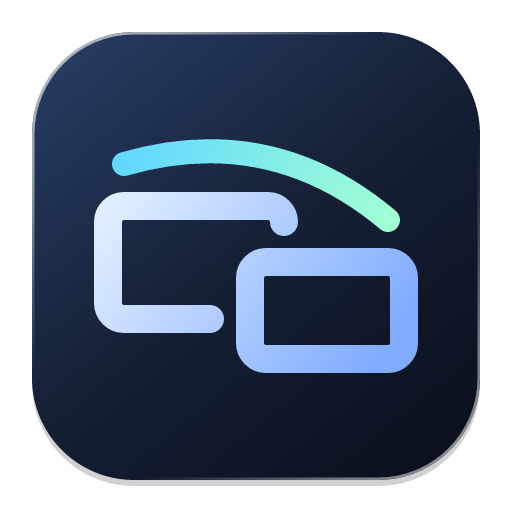

<p align="center">
  
</p>

<h1 align="center">Legato</h1>

<p align="center">
  윈도우 &lt;-&gt; 맥 화면공유를 편하게 하기위한 앱.<br/>
  IP 와 포트 하나로 바로 붙는 Mac · Windows 원격 데스크톱. 중계 서버 없음.
</p>

<p align="center">
  <a href="https://github.com/HDomi/legato/releases/latest"></a>
  <a href="https://github.com/HDomi/legato/actions/workflows/ci.yml"></a>
  <a href="https://github.com/HDomi/legato/actions/workflows/release.yml"></a>
  
  
</p>

<p align="center">
  <a href="https://github.com/HDomi/legato/releases/latest"><b>⬇ 최신 버전 다운로드</b></a>
  &nbsp;·&nbsp;
  <a href="#설치">설치</a>
  &nbsp;·&nbsp;
  <a href="#회사에서-집-mac-에-접속하기">회사에서 집 Mac 접속</a>
  &nbsp;·&nbsp;
  <a href="#보안">보안</a>
  &nbsp;·&nbsp;
  <a href="#문제-해결">문제 해결</a>
</p>

<p align="center">
  <code>Rust</code> · <code>QUIC</code> · <code>ScreenCaptureKit</code> · <code>wgpu</code> · <code>Tauri</code> · <code>React</code> · 개인용
</p>

---

> **현재 단계: P0~P6 구현.** Mac · Windows 모두 호스트 · 뷰어. Windows 쪽 기능(호스트 · 서비스 모드)과 macOS 로그인 화면 접속은 실제 기기 검증 전이다. [로드맵](#로드맵)의 검증 상태 참고.

## 목차

- [왜 만들었나](#왜-만들었나)
- [하이라이트](#하이라이트)
- [주요 기능](#주요-기능)
- [설치](#설치)
- [사용법](#사용법)
- [회사에서 집 Mac 에 접속하기](#회사에서-집-mac-에-접속하기)
- [명령줄](#명령줄)
- [보안](#보안)
- [동작 원리](#동작-원리)
- [파일 위치](#파일-위치)
- [문제 해결](#문제-해결)
- [개발](#개발)
- [릴리스](#릴리스)
- [로드맵](#로드맵)

## 왜 만들었나

회사 컴퓨터에서 집 Mac 을, 또는 Mac 과 Windows 를 오가며 화면을 보고 조작하고 싶었다. 기존 원격 앱은 계정 · 중계 서버 · 구독이 붙거나, Mac ↔ Windows 조합에서 불편하다.
Legato 는 원격받는 쪽이 UDP 포트 하나만 열어두면 IP 로 바로 붙는다. 중간 서버 없이 두 컴퓨터가 직접 암호화 연결을 맺는다.

- **Mac 뷰어는 전체화면 Space 로 열린다.** 원격 화면이 Mission Control 의 별도 Space 가 되어 트랙패드 스와이프로 내 화면과 원격 화면을 오간다.
- **나만 아는 고정 접속 코드.** 한 번 키체인에 저장하면 다음부터 주소록에서 클릭 한 번으로 접속한다. 옆 사람에게 알려줄 때는 매번 바뀌는 표시 비밀번호를 쓴다.
- **이름은 Vibrato 의 형제.** 음을 끊지 않고 이어 연주하라는 *legato* 처럼 끊김 없이 이어지는 연결.

## 하이라이트

- **직접 연결**: QUIC(UDP) 하나. 계정 · 중계 서버 · 클라우드 없음.
- **낮은 지연**: Mac 하드웨어 인코딩(VideoToolbox) 루프백 측정 1920×1248 · 30fps · 지연 중간값 14ms, 고화질 3320×2160 · 지연 중간값 28ms (M4 MacBook Air, `--headless`).
- **지연이 쌓이지 않는 전송**: 뷰어가 디코딩한 프레임을 확인 응답하고, 호스트는 확인 안 된 프레임이 RTT+100ms 보다 오래되면 새 프레임을 보내지 않는다. BBR 혼잡 제어, 영상 · 입력 · 클립보드 스트림 분리와 우선순위.
- **화질 자동 조절**: 네트워크 · 뷰어 처리량을 보고 고화질 / 균형 / 절약을 오르내린다.
- **멀티 모니터 · 클립보드**: 원격 모니터마다 창(Mac 은 Space), 텍스트 클립보드 양방향.
- **두 가지 자격 증명**: 화면에 보이는 **표시 비밀번호**(켤 때마다 교체) + 나만 아는 **고정 접속 코드**(해시만 저장). 둘 중 하나만 맞으면 된다.
- **무인 접속**: 로그인 시 실행 → 바로 접속 대기 → 대기 중 잠자기 방지. macOS 로그인 화면 · Windows 로그인 화면 · UAC 창까지(서비스 모드).
- **원격 잠금 해제**: 호스트 화면이 잠겨 있으면 뷰어에 🔒 로 알리고, 메뉴의 **잠금 화면 깨우기** 로 깨운 뒤 암호를 입력한다. 세션 중에는 호스트 화면이 저절로 잠기지 않는다.
- **한/영 전환**: 원격 메뉴의 한/영 키(또는 Caps Lock 을 한/영으로)로 호스트의 입력 소스를 바꾼다.
- **한국어 · 영어**: 앱 · 뷰어 · 호스트 안내 문구 모두. 설정 탭에서 바꾸고, 기본은 한국어.
- **앱 안 업데이트**: 새 릴리스를 배지로 알리고, 받은 파일을 체크섬 · 서명으로 확인한 뒤 교체한다.
- **강한 기본 보안**: TLS 1.3, 호스트 지문 고정, 비밀번호를 네트워크로 보내지 않는 상호 인증, 무차별 대입 잠금(병렬 추측 · 주소 바꿔 가며 추측까지), root · SYSTEM 으로 도는 부분은 관리자 전용 경로에서만 실행.
- **네이티브 성능**: 캡처 · 인코딩 · 렌더는 Rust. UI 만 Tauri(React)라 앱이 가볍다(약 28MB).

## 주요 기능

| 영역 | 내용 |
|------|------|
| **화면 전송** | Mac: ScreenCaptureKit(NV12) → VideoToolbox 하드웨어 H.264(Constrained Baseline, 안 되면 OpenH264). Windows: DXGI Desktop Duplication → OpenH264. 화질 단계 자동 · 고화질(최대 3840×2160 · 60fps) · 균형(1920 · 30fps) · 절약(1280 · 24fps). 화면 변화가 없으면 보내지 않고, 밀리면 원본 프레임을 버려 지연이 쌓이지 않는다. 인코더가 죽으면 자동으로 다시 시작 |
| **자동 화질** | 버린 프레임 · 전송 대기 · 뷰어 키프레임 재요청을 1초마다 보고 2초 혼잡이면 내리고 10초 여유면 올린다. 내린 뒤에는 30초~10분 동안 다시 올리지 않아 출렁이지 않는다 |
| **조작** | 마우스 이동 · 클릭 · 드래그 · 더블/트리플 클릭 · 가운데 · 앞/뒤 버튼, 휠과 트랙패드 스크롤, 키보드(물리 키 위치 기준이라 한글 · 영문 자판과 무관). Mac ↔ Windows 사이에서는 Cmd ↔ Ctrl 자동 교환. ⌘Q 등 단축키도 원격으로 간다. Ctrl+Alt+Del 은 메뉴에서 |
| **뷰어 창** | 원격 모니터마다 창 하나. Mac: 로컬 모니터마다 나눠서 네이티브 전체화면(Space), `--windowed` 로 일반 창. Windows: 일반 창. 레터박스 · HiDPI 대응 |
| **뷰어 메뉴** | 상태(핑 · fps · 디코딩 시간 · 화질, 잠김이면 🔒), 연결 끊기, 잠금 화면 깨우기, Ctrl+Alt+Del 보내기, 화질(자동 · 고화질 · 균형 · 절약), 디스플레이 켜고 끄기, Cmd ↔ Ctrl 바꾸기, Caps Lock 을 한/영으로, 클립보드 공유 |
| **지연 제한** | 뷰어가 프레임마다 확인 응답(FrameAck). 확인 안 된 프레임이 RTT+100ms 보다 오래됐거나 90장을 넘으면 호스트가 인코딩을 건너뛰어 지연이 쌓이지 않는다(느린 뷰어 시험에서 지연 중간값 339ms → 157ms). BBR 혼잡 제어, 영상은 입력 · 제어보다 낮은 우선순위 |
| **한/영** | 한/영 키(Lang1)를 Mac 호스트는 입력 소스 전환으로, Windows 호스트는 VK_HANGUL 로 보낸다. Mac 뷰어에서 Caps Lock 을 한/영으로 쓸 수 있다(설정 탭) |
| **잠금 해제** | 잠김 감지(Mac: 세션 정보, Windows: 입력 데스크톱 이름) → 뷰어에 알림. **잠금 화면 깨우기** 로 디스플레이를 켜고 암호 입력 창을 띄운다. 세션 중 화면 잠김 · 디스플레이 잠자기 방지 |
| **클립보드** | 텍스트 양방향 동기화 (최대 1MB). 메뉴에서 끌 수 있다. 접속한 순간의 기존 내용은 보내지 않는다 |
| **자격 증명** | 표시 비밀번호(사람이 읽기 쉬운 `xxxx-xxxx-xxxx`, 켤 때마다 새로 · 끄기 가능) + 고정 접속 코드(10자 이상, 호스트엔 PBKDF2 해시만). 표시 비밀번호를 끄면 접속 코드로만 들어온다 |
| **키체인 저장** | 고정 접속 코드로 인증에 성공했을 때만 macOS 키체인 / Windows 자격 증명 관리자에 저장. 주소록에 "코드 저장됨" 표시와 **바로 접속** 버튼. 표시 비밀번호는 저장하지 않는다 |
| **주소록** | 이름 · 주소 저장, 코드 지우기, 삭제. 비밀 값은 주소록 파일에 넣지 않는다 |
| **무인 접속** | "로그인하면 Legato 실행"(최소화로 시작), "켜지면 바로 접속 대기", 대기 중 시스템 잠자기 방지(화면은 꺼져도 됨), 접속 순간 디스플레이 깨우기 |
| **로그인 화면 (macOS)** | 로그아웃 · 재부팅 뒤 로그인 화면에서도 접속을 받는 LaunchAgent (관리자 암호로 설치) |
| **서비스 모드 (Windows)** | SYSTEM 서비스가 로그인 전부터 대기. 로그인 · 잠금 화면, UAC 확인 창 캡처와 입력, 관리자 권한 창 조작, Ctrl+Alt+Del |
| **세션** | 한 번에 한 뷰어. 인증을 통과한 새 접속이 기존 세션을 넘겨받아 네트워크가 끊겼다 붙어도 바로 들어오고, 밀려난 쪽엔 이유를 알려준다 |
| **설정 탭** | 언어(한국어 · English), 업데이트 확인 · 설치와 자동 확인, 서명 · 권한 유지 안내, 로그인하면 실행 · 바로 접속 대기, Caps Lock 한/영 |
| **업데이트** | 설정 탭이나 헤더 배지 → 노트 확인 → **업데이트하고 다시 열기**. 지금보다 새 버전만 설치한다. Mac 은 zip 을 체크섬 · 번들 id · 버전 · 서명으로 확인 후 교체(실패하면 원래 앱 복구), Windows 는 설치 파일 실행. 원격 세션 중이면 먼저 묻고, 켜져 있던 호스트는 다시 켠다 |
| **안내** | 권한이 없거나 캡처가 실패하면 이유를 뷰어에 그대로 보여준다. 호스트에 입력 권한이 없으면 접속 직후 알림 |

## 설치

### 요구 사항

| | 호스트 (원격받는 쪽) | 뷰어 (접속하는 쪽) |
|---|---|---|
| **macOS** | 14 이상, Apple Silicon | 14 이상, Apple Silicon |
| **Windows** | 10 / 11 x64 (로그인 화면 · UAC 까지 쓰려면 서비스 모드) | 10 / 11 x64 |

### macOS

1. [최신 릴리스](https://github.com/HDomi/legato/releases/latest) 에서 `Legato-<버전>-arm64.dmg` 를 받는다.
2. 앱을 `응용 프로그램` 폴더로 끌어 놓는다.
3. Apple 공증을 받지 않은 앱이라 처음 한 번은 macOS 가 막는다. 시스템 설정 › 개인정보 보호 및 보안 › "그래도 열기", 또는:

```bash
find "/Applications/Legato.app" -exec xattr -d com.apple.quarantine {} + 2>/dev/null
```

4. 호스트로 쓸 Mac 은 **이 컴퓨터 열기** 탭의 **권한 요청** 으로 **화면 기록**과 **손쉬운 사용**을 허용한다. Apple 정책상 원격으로는 허용할 수 없어서 처음 한 번은 그 Mac 앞에서 직접 해야 한다.

### Windows

[최신 릴리스](https://github.com/HDomi/legato/releases/latest) 에서 `Legato_<버전>_x64-setup.exe` 를 받아 설치한다. 코드 서명이 없어서 SmartScreen 경고가 뜨면 "추가 정보 › 실행".

호스트로 쓸 PC 는 **이 컴퓨터 열기** › **Windows 서비스 모드** › **서비스 설치** (관리자 권한 확인 창). 그러면 Windows 가 켜지는 순간부터 로그인 화면 · UAC 창까지 원격으로 다룰 수 있다. 서비스 없이 앱의 **켜기** 만 쓰면 로그인한 동안, 일반 권한 창만 조작된다.

<details>
<summary><b>받은 파일 체크섬 확인</b></summary>

릴리스마다 `SHA256SUMS.txt` 가 함께 올라간다.

```bash
cd ~/Downloads
curl -LO https://github.com/HDomi/legato/releases/latest/download/SHA256SUMS.txt
shasum -a 256 -c SHA256SUMS.txt --ignore-missing
```

</details>

### 소스에서 빌드

[개발](#개발) 참고. 첫 릴리스 전에는 이 방법만 된다.

## 사용법

**원격받는 컴퓨터 (호스트)**

1. **이 컴퓨터 열기** 탭 › **켜기**.
2. 화면에 나온 **주소**(예: `192.168.0.10:47820`)와 **표시 비밀번호**를 접속할 사람에게 알려준다.

**접속하는 컴퓨터 (뷰어)**

1. **접속하기** 탭에 주소와 비밀번호(또는 고정 접속 코드)를 넣고 **접속**.
2. Mac 은 원격 화면이 새 Space 로 열린다. 트랙패드 좌우 스와이프나 Mission Control 로 오간다.
3. 원격 모니터가 여러 대면 창이 여러 개 열린다 (Mac 은 로컬 모니터마다 나눠 Space).
4. 메뉴 막대 **원격** 에서 화질 · 디스플레이 · Ctrl+Alt+Del · Cmd↔Ctrl · 클립보드를 바꾼다. 끝낼 때는 **Legato(뷰어) › 연결 끊기** (⌘Q 는 원격으로 간다). 전체화면에서 나오려면 화면 위쪽에 마우스를 올려 초록 버튼.

처음 접속한 호스트의 인증서 지문은 기억된다. 나중에 지문이 바뀌면 접속을 거부하고 경고한다(호스트를 다시 설치했거나 중간에서 가로채는 경우). 확실할 때만 **새 지문 믿고 다시 접속**.

## 회사에서 집 Mac 에 접속하기

**집 Mac (한 번만)**

1. **이 컴퓨터 열기** › **고정 접속 코드** › **설정**. 10자 이상, 다른 곳에 쓰지 않는 값으로. 저장하면 다시 보이지 않으니 따로 기억해 둔다.
2. **무인 접속** 에서 "로그인하면 Legato 실행", "Legato 가 켜지면 바로 접속 대기" 를 켠다.
3. 화면 기록 · 손쉬운 사용 권한을 허용한다.
4. (선택) 접속 코드로만 들어오게 하려면 "표시 비밀번호로 접속 허용" 을 끈다.

**네트워크**

- **권장: VPN.** 집 Mac 과 회사 컴퓨터를 [Tailscale](https://tailscale.com) · WireGuard 같은 VPN 에 넣고 VPN 주소로 접속한다. 포트를 인터넷에 열 필요가 없다.
- **포트포워딩:** 공유기에서 UDP `47820` → 집 Mac 으로 포워딩하고 공인 IP 로 접속한다. **원격 제어 포트를 인터넷에 그대로 여는 것은 위험하다.** 잠금 · 지문 고정이 있어도 전 세계 스캔 대상이 된다.

**회사 컴퓨터**

1. **접속하기** 에 집 주소와 고정 접속 코드를 넣고 "키체인에 저장" 을 체크한 채 **접속**.
2. 다음부터는 주소록의 **바로 접속** 한 번.

**로그아웃 · 재부팅 대비 (선택)**

집 Mac 에서 **로그인 화면에서도 접속 (macOS)** › **켜기** (관리자 암호). 로그인 화면이 떠 있는 동안 고정 접속 코드로 접속할 수 있다. 실행 파일과 설정을 root 전용 위치에 복사해 두는 방식이라, 앱을 업데이트하거나 접속 코드를 바꾸면 같은 자리에 **다시 적용** 버튼이 나온다. 눌러야 로그인 화면에도 반영된다 (Windows 서비스 모드도 업데이트 뒤 같은 버튼).

**화면이 잠겨 있을 때**

뷰어 메뉴 상태 줄에 🔒 가 붙는다. **원격 › 잠금 화면 깨우기** 로 디스플레이를 켜고 암호 입력 창을 띄운 뒤 원격으로 Mac 암호를 입력한다. 접속해 있는 동안에는 호스트 화면이 저절로 잠기지 않는다.

**주의 · 검증 전**

- macOS 로그인 화면 접속과 화면 잠금 상태의 캡처 · 입력은 아직 실제로 검증하지 않았다. 출근 전에 집 Mac 에서 로그아웃 → 다른 기기로 접속을 한 번 시험해 본다.
- FileVault 를 켠 Mac 은 재부팅 직후 디스크 잠금 해제 화면(macOS 가 뜨기 전)에서는 어떤 방법으로도 접속할 수 없다.

## 명령줄

앱 없이 쓰거나 스크립트로 돌릴 때. 실행 파일은 `Legato.app/Contents/MacOS/` 안에 있다.

```bash
# 호스트
legato-host serve                                     # 접속 대기
legato-host serve --max-width 2560 --fps 30 --bitrate 12000000   # 화질 상한 (기본 3840 · 60 · 20Mbps)
legato-host serve --allow-sleep                       # 대기 중에도 잠자기 허용 (기본은 막음)
legato-host set-password --generate                   # 표시 비밀번호 새로 만들기
echo '나만-아는-긴-접속-코드' | legato-host set-access-code   # 고정 접속 코드 (10자 이상, 해시만 저장)
legato-host clear-access-code
legato-host configure --rotate-display-password=false  # 표시 비밀번호를 켤 때마다 바꾸지 않기
legato-host configure --allow-display-password=false   # 접속 코드로만 접속 (코드가 있어야 함)
legato-host info                                      # 주소 · 지문 · 권한 · 설정 상태
legato-host request-permissions                       # macOS 권한 요청 창 띄우기
sudo legato-host login-agent install                  # macOS 로그인 화면 에이전트 (uninstall / status)
legato-host service install                           # Windows 서비스 모드, 관리자 (uninstall / status)

# 뷰어 (비밀번호·접속 코드는 LEGATO_PASSWORD 환경 변수, 없으면 프롬프트)
legato-viewer 192.168.0.10                            # 포트 생략 시 47820
legato-viewer 192.168.0.10:47820 --windowed --display 1 --display 2   # 특정 모니터만 (생략하면 전부)
legato-viewer 192.168.0.10 --quality high             # auto | high | balanced | low
legato-viewer 192.168.0.10 --no-clipboard --no-swap-cmd-ctrl
legato-viewer 192.168.0.10 --accept-new-fingerprint   # 바뀐 지문을 받아들이기
legato-viewer 192.168.0.10 --headless --frames 120 --dump frame.png   # 창 없이 FPS · 지연 측정
```

호스트와 뷰어는 표준 출력으로 상태 이벤트를 JSON 한 줄씩 내보낸다(`listening`, `session_started`, `connected`, `closed` 등). 사람용 로그는 표준 에러로 나간다. `RUST_LOG=debug` 로 자세히, `--log-file <경로>` 로 파일에. `LEGATO_SOFTWARE_ENCODER=1` 이면 Mac 에서도 OpenH264 를 쓴다(비교용).

## 보안

| 항목 | 방식 |
|------|------|
| **암호화** | QUIC 위 TLS 1.3 (rustls + ring). 영상 · 입력 · 제어 모두 암호화 |
| **호스트 확인** | 호스트는 처음 실행 때 만든 자체 서명 인증서를 계속 쓴다. 뷰어는 SHA-256 지문을 처음 접속 때 기억하고(TOFU) 이후 바뀌면 거부. 서명 검증(CertificateVerify)은 정상 수행 |
| **인증** | 비밀번호 · 접속 코드는 네트워크로 보내지 않는다. 호스트가 슬롯별 salt 와 nonce 를 주면 뷰어가 `HMAC(PBKDF2-SHA256(값, 20만 회), nonce ‖ TLS exporter)` 로 답한다. TLS 채널 바인딩이라 중간자가 다른 TLS 세션으로 중계하면 실패한다 |
| **상호 인증** | 호스트도 같은 키로 만든 증명을 돌려줘야 뷰어가 연결을 유지한다. 비밀번호를 모르는 가짜 호스트는 걸러진다. 지문은 이 증명이 통과한 뒤에만 저장한다 |
| **무차별 대입** | 주소(IPv6 는 /64) 별 5회 실패하면 30초 잠금, 이후 실패마다 두 배(최대 1시간). 잠긴 동안은 맞는 값도 거부. 같은 주소의 인증은 한 번에 하나만(병렬 추측 차단), 모든 주소 합쳐 1분에 20회 넘게 실패하면 30초 동안 전부 거부. 인증 전 연결은 32개까지, 인증 전 메시지는 4KB 까지 |
| **가짜 호스트 대비** | 뷰어는 PBKDF2 반복 10만 회 미만을 요구하는 호스트를 거부한다. 지문이 바뀐 호스트에는 저장한 접속 코드를 자동으로 보내지 않는다(직접 입력해야 함) |
| **권한 분리** | macOS 로그인 화면 에이전트(root)는 `/Library/PrivilegedHelperTools` 에 복사한 실행 파일과 root 만 읽는 설정 사본(접속 코드만, 표시 비밀번호 제외)을 쓴다. Windows 서비스(SYSTEM)는 `Program Files\Legato\service` 에 복사한 실행 파일로 돌고, 로그는 관리자 전용 `ProgramData\Legato\logs` 에 쓰며 사용자 설정 폴더에는 쓰지 않는다. 방화벽 규칙은 개인 · 도메인 네트워크에만 연다 |
| **업데이트** | 체크섬, 번들 id · 버전, 서명(인증서 서명 빌드면 같은 인증서인지까지) 확인 후 교체. 예전 버전으로 되돌리는 설치는 거부 |
| **CI** | 워크플로 기본 권한은 읽기 전용(릴리스 게시 잡만 쓰기), 외부 액션은 커밋 SHA 로 고정 |
| **저장** | 고정 접속 코드: 호스트엔 PBKDF2 결과만(원문 없음), 뷰어엔 OS 키체인. 표시 비밀번호: 화면에 보여주는 값이라 호스트 설정 파일에 원문 저장. 설정 · 인증서 파일은 본인만 읽기(macOS 0600, 임시 파일 링크 바꿔치기 방지), 로그 파일도 0600. macOS 키체인 항목은 업데이트 뒤 암호를 다시 묻지 않도록 같은 사용자의 다른 앱도 읽을 수 있게 저장한다(공용 컴퓨터에서는 저장하지 않는다) |
| **세션** | 한 번에 한 뷰어. 비밀 값은 명령줄 인자로 넘기지 않는다(`ps` 에 안 보이게 환경 변수 · 표준 입력) |

**주의**

- 호스트의 `identity.json`(TLS 개인키)과 `host.json` 은 비밀번호와 같은 효력이다. 백업 · 동기화 폴더에 넣지 않는다.
- PBKDF2 결과 자체가 이 프로토콜에서는 키 역할을 하므로 `host.json` 이 유출되면 접속 코드를 바꿔야 한다.
- 고정 접속 코드는 길게. 인터넷에 직접 노출한다면 더더욱. 가능하면 VPN.

## 동작 원리

```
┌─ 뷰어 (접속하는 쪽) ──────────────┐            ┌─ 호스트 (원격받는 쪽) ─────────────┐
│ Legato 앱 (Tauri + React)         │            │ Legato 앱 (Tauri + React)          │
│   └ legato-viewer (세션마다 1개)  │   QUIC     │   └ legato-host serve              │
│       winit 창 · wgpu YUV 렌더    │ ◀════════▶ │       ScreenCaptureKit (NV12)      │
│       OpenH264 디코딩             │  UDP 47820 │       → OpenH264 인코딩            │
│       입력 수집 (W3C 키 코드)     │            │       CGEvent 입력 주입            │
└───────────────────────────────────┘            └────────────────────────────────────┘
```

- **연결**: 뷰어가 양방향 제어 스트림을 연다(Hello → 챌린지 → 응답 → AuthOk). 이후 화면 선택 · 입력 · 키프레임 요청이 이 스트림으로 간다.
- **영상**: 호스트가 단방향 스트림을 열어 길이 접두 `VideoPacket`(Annex-B H.264, 캡처 시각 포함)을 이어 보낸다. 네트워크가 막히면 인코더 쪽에서 원본 프레임을 버린다.
- **프로세스 분리**: 뷰어 창의 이벤트 루프가 Tauri 와 메인 스레드를 두고 충돌하지 않게, 그리고 세션 하나가 죽어도 앱이 멀쩡하게 뷰어 · 호스트는 별도 실행 파일이다.

| 크레이트 | 역할 |
|---|---|
| `crates/legato-core` | 프로토콜 · framing, QUIC 엔드포인트 · 지문 검증, 인증 · 잠금, OpenH264 코덱, 설정 경로 |
| `crates/legato-host` | `legato-host` CLI. 캡처 · 인코딩 · 전송, 입력 주입, 세션 관리, 잠자기 방지 |
| `crates/legato-viewer` | `legato-viewer` CLI. 접속 · 인증, 디코딩, wgpu 렌더, 입력 전송, headless 측정 |
| `app/` | Tauri v2 + React. 주소록 · 호스트 제어 · 키체인 · 로그인 시 실행 |
| `assets/icon.svg` | 앱 아이콘 원본 (Vibrato 와 같은 바탕 · 은색 테두리 · 음영) |
| `scripts/` | 사이드카 빌드, 서명 인증서 생성, 서명, 버전 올리기 |

## 파일 위치

| 내용 | macOS | Windows |
|------|-------|---------|
| 설정 폴더 | `~/Library/Application Support/com.hdomi.Legato/` | `%APPDATA%\hdomi\Legato\config\` |
| `host.json` | 포트, 표시 비밀번호, 고정 접속 코드 해시, 옵션 | 〃 |
| `identity.json` | 호스트 TLS 인증서 · 개인키 | 〃 |
| `known_hosts.json` | 접속한 호스트 지문 | 〃 |
| `addressbook.json` | 주소록 (비밀 값 없음) | 〃 |
| `app.json` | 앱 설정 (자동 접속 대기) | 〃 |
| 저장한 접속 코드 | 키체인, 서비스 `com.hdomi.legato`, 계정 = 주소 | 자격 증명 관리자 |
| 로그인 시 실행 | `~/Library/LaunchAgents/` 의 Legato 항목 | 레지스트리 `Run` |
| 로그인 화면 에이전트 | `/Library/LaunchAgents/com.hdomi.legato.loginwindow.plist`, 실행 파일 `/Library/PrivilegedHelperTools/com.hdomi.legato.host`, 설정 사본 `/Library/Application Support/Legato/loginwindow/`, 로그 `/Library/Logs/Legato/loginwindow.log` | — |
| 서비스 모드 | — | 서비스 `LegatoHost`, 실행 파일 `C:\Program Files\Legato\service\legato-host.exe`, 로그 `C:\ProgramData\Legato\logs\` 의 `service.log` · `host-helper.log`, 방화벽 규칙 "Legato 호스트 (UDP)" |
| 업데이트 임시 파일 | `~/Library/Caches/com.hdomi.legato/update/` | `%TEMP%\Legato-update\` |

`LEGATO_CONFIG_DIR` 환경 변수로 설정 폴더를 바꿀 수 있다 (여러 인스턴스 테스트용).

**삭제**: 로그인 화면 에이전트 · 서비스 모드를 먼저 끄고(앱 버튼), 앱을 지우고 설정 폴더를 지운다. 키체인에서 `com.hdomi.legato` 항목을, 시스템 설정 › 개인정보 보호 및 보안에서 화면 기록 · 손쉬운 사용 항목을 지운다.

## 문제 해결

| 증상 | 원인 · 해결 |
|------|------------|
| "손상되었기 때문에 열 수 없습니다" / "확인되지 않은 개발자" | 공증하지 않은 앱이라 그렇다. `find "/Applications/Legato.app" -exec xattr -d com.apple.quarantine {} + 2>/dev/null` 후 다시 연다 |
| "응답 없음 (포트·방화벽 확인)" | 호스트가 꺼져 있거나 UDP 포트가 막힘. 호스트 화면이 "접속 대기 중" 인지, 같은 네트워크인지, 외부라면 포트포워딩 · VPN 을 확인 |
| "호스트 화면을 가져올 수 없어" · "화면 캡처를 시작할 수 없어" | 호스트 Mac 에 화면 기록 권한이 없음. 그 Mac 에서 **권한 요청** 후 Legato 를 다시 켠다 |
| "응답 없음. 호스트 Mac 에 화면 기록 권한 확인 창이…" | macOS 가 권한 확인 창을 띄우고 기다리는 중. 호스트 Mac 에서 허용 |
| 화면은 보이는데 마우스 · 키보드가 안 먹음 | 호스트에 손쉬운 사용 권한이 없음 (접속 직후 창 제목에 안내가 뜬다). 허용 후 Legato 를 다시 켠다 |
| 업데이트할 때마다 권한을 다시 허용해야 함 | ad-hoc 서명 빌드. [Mac 서명](#mac-서명-자체-서명-인증서) 의 자체 서명 인증서로 만든 릴리스를 쓴다 |
| "키체인에서 Legato 이 … 사용하려고 합니다" 창 | 저장한 접속 코드를 다른 서명의 앱이 읽으려는 것(ad-hoc 빌드로 업데이트한 경우). 허용하거나, 자체 서명 릴리스를 쓴다 |
| "인증서 지문이 예전과 달라" | 호스트를 다시 설치해 인증서가 바뀌었거나 중간자. 호스트 화면의 지문과 같은지 눈으로 확인한 뒤에만 **새 지문 믿고 다시 접속** |
| "비밀번호를 너무 많이 틀려서 잠겼어" | 5회 실패 잠금. 표시된 시간 뒤에 다시 시도. 호스트를 다시 켜도 풀린다 |
| "다른 곳에서 이 호스트에 접속해서 이 연결은 끊겼어" | 다른 뷰어가 인증하고 세션을 넘겨받았다 (한 번에 한 뷰어) |
| 원격 화면이 검게 나옴 | 호스트 디스플레이가 잠들었거나 잠금 화면. 접속하면 깨우기를 시도하지만 잠금 화면 캡처는 아직 검증 전 |
| 원격으로 `⌘Tab` · `⌘Space` 가 안 감 | macOS 가 시스템 단축키를 먼저 가져간다. 다른 단축키(⌘Q 포함)는 원격으로 간다 |
| Windows 에서 UAC 창 · 로그인 화면이 안 보임 / 관리자 창이 안 눌림 | 서비스 모드가 아니면 Windows 가 막는다. **Windows 서비스 모드** 설치 |
| Ctrl+Alt+Del 이 안 됨 | Windows 서비스 모드에서만 된다 (설치할 때 SoftwareSASGeneration 정책을 켠다) |
| 업데이트가 "응용 프로그램 폴더로 옮겨" 라고 함 | DMG 안이나 격리된 위치에서 실행한 것. `/Applications` 로 옮긴 뒤 다시 |
| 업데이트 후 앱이 그대로 | `~/Library/Caches/com.hdomi.legato/update/<버전>/install.log` 확인. 교체 실패 시 원래 앱으로 복구된다 |
| 화질이 자꾸 내려감 | 네트워크나 뷰어 처리량이 부족하다는 신호. 메뉴에서 단계를 고정하거나 `serve --bitrate` 로 상한을 낮춘다 |

## 개발

필요: Rust stable, Node 22, (Mac) Xcode.

```bash
cargo test                       # core · host · viewer 테스트
cargo clippy -- -D warnings
cargo build --release            # target/release/legato-host, legato-viewer

cd app && npm install
npm run sidecars                 # 호스트 · 뷰어를 릴리스로 빌드해 Tauri 사이드카 위치로 복사 (dev 전에 한 번)
npx tauri dev                    # 앱 개발 모드
npx tauri build --bundles app    # target/release/bundle/macos/Legato.app
```

같은 Mac 에서 호스트 · 뷰어를 같이 돌려 보기:

```bash
export LEGATO_CONFIG_DIR=/tmp/lg-host
target/release/legato-host serve --port 47999          # 표준 출력 JSON 의 display_password 이벤트에 표시 비밀번호가 나온다
LEGATO_CONFIG_DIR=/tmp/lg-viewer LEGATO_PASSWORD=<표시 비밀번호> \
  target/release/legato-viewer --headless --frames 120 --dump /tmp/frame.png -- 127.0.0.1:47999
```

- 코드 주석은 한글로 쓴다. 작업은 `main` 브랜치에서 한다.
- 아이콘은 `assets/icon.svg` 를 고친 뒤 `cd app && npx tauri icon ../assets/icon.svg -o src-tauri/icons` (생성된 `android/`, `ios/` 폴더는 지운다).
- CI(`.github/workflows/ci.yml`): Mac · Windows 에서 테스트 · clippy, Mac · Windows 에서 앱 빌드. 실패하면 로그 끝부분을 요약(annotation)으로 남긴다.
- 문구는 Rust 쪽 `t!("한국어", "English")`(`legato_core::i18n`, 환경 변수 `LEGATO_LANG`), 앱 쪽 `app/src/i18n.tsx` 사전. 한국어는 존댓말로 쓴다.
- `LEGATO_DEBUG_NO_LATENCY_LIMIT=1`(호스트) · `LEGATO_DEBUG_DECODE_DELAY_MS=60`(뷰어)로 지연 제한 효과를 비교할 수 있다.

## 릴리스

Vibrato 와 같은 방식: 버전 태그를 푸시하면 GitHub Actions(`release.yml`)가 빌드해서 릴리스에 올린다.

```bash
scripts/bump-version.sh 0.2.0        # Cargo · tauri.conf.json · package.json 버전을 한 번에
git commit -am "release: v0.2.0"
git tag -a v0.2.0 -m "변경 내용"      # 태그 메시지가 릴리스 노트가 된다
git push --follow-tags
```

| 파일 | 용도 |
|------|------|
| `Legato-<v>-arm64.dmg` | macOS 설치 |
| `Legato-<v>-arm64-mac.zip` | 앱 안 업데이터용 (P6) |
| `Legato_<v>_x64-setup.exe` | Windows 설치 (NSIS) |
| `SHA256SUMS.txt` | 체크섬 |

### Mac 서명 (자체 서명 인증서)

ad-hoc 서명은 빌드마다 서명 해시가 바뀌어 macOS 가 화면 기록 · 손쉬운 사용 권한과 키체인 접근 허용을 업데이트마다 초기화한다. 원격 앱에는 치명적이라 **같은 자체 서명 인증서로 계속 서명**한다. 지정 요구사항이 `certificate root = H"…"` 로 고정돼 권한이 유지된다.

1. 한 번만: `scripts/make-signing-cert.sh ~/legato-signing` (레포 밖에 만든다).
2. GitHub 레포 Settings › Secrets › Actions 에 `MACOS_CERT_P12_BASE64`, `MACOS_CERT_PASSWORD` 등록.
3. 그 폴더는 안전한 곳에 백업. 잃어버리면 새 인증서가 되어 모든 Mac 에서 권한을 한 번 다시 허용해야 한다.

서명은 `scripts/sign-macos.sh` 가 [rcodesign](https://github.com/indygreg/apple-platform-rs) 으로 한다 (Apple `codesign` 은 신뢰되지 않은 자체 서명 인증서를 "identity 없음" 으로 거부해서). 태그 릴리스는 Secrets 가 없으면 실패한다 (업데이트마다 권한이 초기화되는 ad-hoc 릴리스가 나가지 않게). 수동 실행(workflow_dispatch)은 ad-hoc 서명으로 대신하고 경고를 남긴다. 공증(notarization)은 하지 않는다.

## 로드맵

| 단계 | 내용 | 상태 |
|---|---|---|
| P0 | workspace, CI, 릴리스 workflow, 자체 서명 | ✅ 동작 확인 |
| P1 | Mac 호스트, Mac/Windows 뷰어, 암호화 · 상호 인증, Tauri 앱, 고정 접속 코드 · 무인 접속, 아이콘 | ✅ Mac 에서 확인 |
| P2 | Windows 호스트 (DXGI 캡처, SendInput, 클립보드) | 🟡 코드 완료, CI 빌드만 확인 · 실제 Windows 실행 전 |
| P3 | 멀티 모니터, Cmd↔Ctrl, 단축키 전달, 클립보드, VideoToolbox, 화질 자동 조절, 뷰어 메뉴 | ✅ Mac 에서 확인 (멀티 모니터는 모니터 1대라 미확인) |
| P4 | Windows SYSTEM 서비스: UAC · 잠금 · 로그인 화면, Ctrl+Alt+Del | 🟡 코드 완료, 실제 Windows 실행 전 |
| P5 | macOS 로그인 화면 에이전트 | 🟡 코드 완료, 로그아웃 상태 검증 전 |
| P6 | 앱 안 업데이터 | ✅ Mac 에서 실제 릴리스로 교체 확인 (Windows 설치 파일 경로는 미확인) |

**남은 일**: Windows 하드웨어 인코더(Media Foundation), Windows 원격 커서 모양 그리기(지금은 뷰어 쪽 로컬 커서만 보임), Windows · 로그인 화면 실제 기기 검증.
